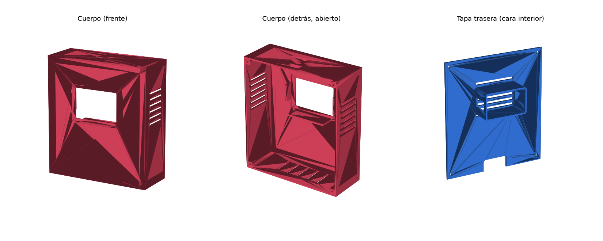

# Piezas impresas y decoración

Diseñadas en Python con [manifold3d](https://github.com/elalish/manifold) + trimesh (paramétricas: cambia las medidas al principio de cada script y vuelve a generar). Impresas en una Bambu H2S, PLA.

| Fichero | Qué es | Cómo imprimir |
|---|---|---|
| `cuerpo.stl` | Caja 180×200×70 mm con ventana para la pantalla de 3,5" y rejillas laterales | Frontal sobre la cama |
| `tapa_trasera.stl` | Tapa de atrás con marco que empuja la pantalla | Plana |
| `prueba_encaje.stl` | Trozo del frontal para probar que encaja la pantalla antes de imprimir la caja | Plana |
| `funda_mando.stl` | Funda para el mando de selfies (24×35×11 mm, con holgura) con agujero para cordón; se pega al lateral | Placa sobre la cama, sin soportes |
| `palos_boton_punta.stl` | Palitos con punta de 2 mm para pulsar el botón de encendido de la Pi por la rejilla (4 largos, marcados con muescas) | Tumbados, sin soportes |
| `clip_palos.stl` | Clip para guardar el palito y el lápiz de la pantalla táctil | Placa sobre la cama, sin soportes |
| `caja_photomaton.py` | Genera caja, tapa, prueba y funda: `python caja_photomaton.py .` | |
| `marco/` | Marco de fiesta para las fotos (`marco.py` genera el PNG 1280×720) | |
| `pegatinas/` | Hoja A4 de pegatinas para decorar la caja (`pegatinas.py` genera el PDF) | Imprimir al 100 % y recortar |

Dependencias: `pip install manifold3d trimesh numpy pillow`.

